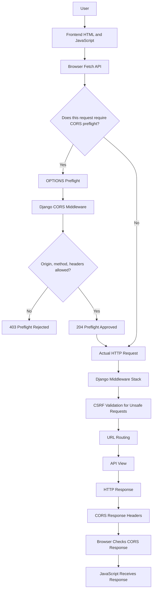

# Django CORS Learning Lab — Project Architecture

## 1. Project Overview

Django CORS Learning Lab is a hands-on project designed to understand how a frontend communicates with a Django backend across different origins.

The project demonstrates Cross-Origin Resource Sharing (CORS), browser preflight requests, HTTP methods, CSRF protection, cookies, request headers, and HTTP responses.

Instead of only learning these concepts theoretically, we implemented custom CORS middleware and tested requests through both a browser and Postman.

### Project objectives

- Understand frontend-to-backend communication.
- Learn why browsers enforce the Same-Origin Policy.
- Implement CORS handling using Django middleware.
- Understand when and why browsers send `OPTIONS` preflight requests.
- Implement CSRF token generation and validation.
- Test allowed and rejected origins.
- Troubleshoot real HTTP errors.
- Prepare the project for documentation and GitHub.

### Technology stack

| Technology | Purpose |
|---|---|
| Python | Backend programming language |
| Django | Backend framework and HTTP request handling |
| JavaScript | Sends HTTP requests from the frontend |
| HTML | Defines the frontend page structure |
| CSS | Styles the frontend |
| HTTP | Communication protocol between frontend and backend |
| Postman | Tests API requests and responses |
| VS Code | Development environment |
| Git and GitHub | Version control and project hosting |

---

## 2. Application Architecture

The project contains two separately running applications.

- **Frontend:** Runs using VS Code Live Server at `http://127.0.0.1:5500`.
- **Backend:** Runs using the Django development server at `http://127.0.0.1:8000`.

Although both applications run on the same computer, their origins differ because their ports are different.

An origin consists of a scheme, hostname, and port.

For example:

| URL | Origin |
|---|---|
| `http://127.0.0.1:5500` | `http://127.0.0.1:5500` |
| `http://127.0.0.1:8000` | `http://127.0.0.1:8000` |
| `http://localhost:5500` | `http://localhost:5500` |

The frontend and backend on ports `5500` and `8000` are cross-origin. Also, `localhost` and `127.0.0.1` are different hostnames, so they represent different origins.

### Architecture diagram



**Important:** Not every cross-origin request requires preflight. Browsers automatically send `OPTIONS` when a request meets the conditions that require CORS preflight.

---

## 3. Final Project Folder Structure

The following structure represents the intended organization of the project.

```text
django-cors-lab/
│
├── backend/
│   ├── config/
│   │   ├── __init__.py
│   │   ├── settings.py
│   │   ├── urls.py
│   │   ├── asgi.py
│   │   └── wsgi.py
│   │
│   ├── api/
│   │   ├── migrations/
│   │   ├── __init__.py
│   │   ├── admin.py
│   │   ├── apps.py
│   │   ├── middleware.py
│   │   ├── models.py
│   │   ├── tests.py
│   │   ├── urls.py
│   │   └── views.py
│   │
│   ├── manage.py
│   ├── requirements.txt
│   └── .env.example
│
├── frontend/
│   ├── index.html
│   ├── style.css
│   └── script.js
│
├── docs/
│   ├── 01-project-architecture.md
│   ├── 02-cors-fundamentals.md
│   ├── 03-options-preflight-flow.md
│   ├── 04-csrf-protection-flow.md
│   └── 05-testing-and-troubleshooting.md
│
├── .gitignore
└── README.md
```

This is the target structure, not a claim that every listed file has already been audited or created. Keep Django's generated files, such as `__init__.py`, `migrations/`, `asgi.py`, and `wsgi.py`, when present.

The project does not need a database model merely to demonstrate CORS and CSRF. The existing welcome endpoint returns JSON without creating a database record.

---

## 4. Responsibility of Each Important File

| File | Responsibility |
|---|---|
| `backend/config/settings.py` | Configures Django, installed apps, middleware, allowed hosts, and CSRF trusted origins. |
| `backend/config/urls.py` | Connects the API URL configuration to the main Django application. |
| `backend/api/middleware.py` | Implements our custom CORS preflight checks and adds CORS response headers. |
| `backend/api/views.py` | Defines the welcome endpoint and CSRF token endpoint. |
| `backend/api/urls.py` | Maps API paths to their corresponding views. |
| `backend/manage.py` | Provides Django management commands. |
| `frontend/index.html` | Defines the page and request buttons. |
| `frontend/style.css` | Controls the frontend appearance. |
| `frontend/script.js` | Sends GET requests and CSRF-protected JSON POST requests. |
| `backend/requirements.txt` | Records Python package dependencies. |
| `.gitignore` | Excludes generated files, local secrets, and other files that should not be committed. |
| `README.md` | Provides the project overview, setup instructions, and links to the documentation. |
| `docs/` | Contains detailed explanations of the architecture, CORS, preflight, CSRF, and testing. |

### Why is middleware important?

Middleware processes HTTP requests and responses around the view layer.

Our custom CORS middleware is positioned before Django's CSRF middleware. This allows it to recognize and handle qualifying preflight requests before they proceed through normal Django request processing.

For an actual POST request, the custom middleware normally calls the next middleware, allowing Django's CSRF checks and view processing to occur.

---

## 5. API Endpoints Implemented

The project currently uses two endpoints.

| Method | Endpoint | Purpose | Expected result |
|---|---|---|---|
| GET | `/api/` | Returns the welcome JSON. | `200 OK` |
| GET | `/api/csrf/` | Provides a CSRF token and ensures a CSRF cookie is set. | `200 OK` |
| OPTIONS | `/api/` | Handles qualifying CORS preflight requests through our middleware. | `204` if allowed; `403` if rejected by the custom preflight checks |
| POST | `/api/` | Demonstrates a CSRF-protected POST request. | `200 OK` when validation succeeds |

### Welcome endpoint response

```json
{
    "message": "Welcome to Django CORS Learning Lab!",
    "status": "success",
    "backend": "Django"
}
```

The current `home()` view returns this response for POST as well as GET. It does not save the submitted `Laptop` payload to a database.

The `OPTIONS` response is generated by the custom middleware for qualifying preflight requests, not by the welcome view.

---

## 6. How the Frontend Communicates with Django

The frontend uses JavaScript's `fetch()` API to send HTTP requests.

### GET request

```javascript
const API_URL = "http://127.0.0.1:8000/api/";

const response = await fetch(API_URL);
const data = await response.json();

console.log(data);
```

The browser sends a GET request to Django. The view returns JSON, and JavaScript reads the response.

### CSRF-protected POST request

```javascript
const csrfResponse = await fetch(API_URL + "csrf/", {
    credentials: "include",
});

const csrfData = await csrfResponse.json();

const response = await fetch(API_URL, {
    method: "POST",
    credentials: "include",
    headers: {
        "Content-Type": "application/json",
        "X-CSRFToken": csrfData.csrfToken,
    },
    body: JSON.stringify({
        name: "Laptop",
    }),
});
```

The POST flow has two logical requests:

1. The frontend obtains a CSRF token and receives the corresponding cookie.
2. The frontend sends the POST with the token header and includes credentials so the relevant cookie can be sent.

Because this is a cross-origin JSON request with a custom header, the browser normally performs a CORS preflight before sending the actual POST.

The browser does not normally include the actual request's cookies in the preflight itself. The preflight response must nevertheless allow credentials for the credentialed actual request.

---

## 7. CORS and CSRF Have Different Responsibilities

CORS and CSRF are related to browser security, but they solve different problems.

| Feature | CORS | CSRF |
|---|---|---|
| Full name | Cross-Origin Resource Sharing | Cross-Site Request Forgery |
| Purpose | Controls browser access to cross-origin responses | Helps prevent forged unsafe requests |
| Implemented here by | `ManualCORSMiddleware` | Django's `CsrfViewMiddleware` |
| Example check | Is the requesting origin allowed? | Is the CSRF cookie and submitted token valid? |
| Example failure | Preflight rejected or response blocked by browser CORS checks | Django returns `403 Forbidden` |

CORS is not authentication or authorization. Non-browser clients such as Postman are not restricted by browser CORS enforcement, although Django's own CSRF checks still apply to their requests.

CSRF protection also does not replace authentication, authorization, input validation, or other API security controls.

---

## 8. Errors Encountered and How We Fixed Them

During implementation, we encountered several issues.

| Problem | Cause | Resolution |
|---|---|---|
| Yellow underlines under Django imports | VS Code's Python analysis had warnings even though Django was installed in the project environment. | Selected the project interpreter and reloaded VS Code. The warnings disappeared. |
| Browser POST returned `403 CSRF cookie not set` | The original frontend POST did not obtain and send the required CSRF information. | Added the CSRF endpoint request, `credentials: "include"`, and the `X-CSRFToken` header. |
| Postman POST returned `403` | The direct Postman POST lacked the required matching CSRF cookie and token. | Requested `/api/csrf/`, then sent the matching cookie and token with the POST. |
| Approved preflight returned `204` | The request passed the custom middleware's origin, method, and header checks. | No fix needed; this was the expected successful result. |
| Unapproved origin returned `403` | `http://localhost:5500` was not included in `ALLOWED_ORIGINS`. | No fix needed; this confirmed the configured origin rejection behavior. |

### What we learned

An HTTP error must be diagnosed according to the component that generated it.

For example, the CSRF failure was not fixed by changing CORS origins. It was fixed by obtaining and submitting the correct CSRF information.

Similarly, a `204` preflight response confirms that the tested preflight was approved; it does not guarantee that every subsequent API request will pass CSRF validation.

---

## 9. Development Setup and Execution

### Prerequisites

- Python installed.
- VS Code installed.
- VS Code Live Server extension installed.
- Postman installed if you want to reproduce the HTTP tests.

### Start the backend

Open a terminal in the `backend/` directory.

Activate the virtual environment in PowerShell:

```powershell
.\venv\Scripts\Activate.ps1
```

Install dependencies if needed:

```powershell
python -m pip install -r requirements.txt
```

Check the Django project:

```powershell
python manage.py check
```

Start the development server:

```powershell
python manage.py runserver 127.0.0.1:8000
```

### Start the frontend

Open `frontend/index.html` in VS Code and select **Open with Live Server**.

Confirm that the frontend origin is:

```text
http://127.0.0.1:5500
```

The backend requests in `script.js` should consistently use:

```text
http://127.0.0.1:8000/api/
```

Avoid mixing `localhost` and `127.0.0.1` in backend URLs because they are different hostnames.

### Verify the endpoints

1. Click **Send GET Request** and verify the welcome JSON.
2. Click **Send JSON POST Request** and verify the successful CSRF-protected response.
3. Use Postman to test the CSRF endpoint and POST request.
4. Send an approved preflight request and verify `204`.
5. Send an unapproved-origin preflight and verify `403`.

---

## 10. Production Considerations and Key Takeaways

This project is a learning implementation, not a production-ready security framework.

Before deploying it:

- Use HTTPS.
- Move the Django secret key into an environment variable and never commit it.
- Set `DEBUG = False` in production.
- Configure `ALLOWED_HOSTS` and `CSRF_TRUSTED_ORIGINS` for the real deployment.
- Configure secure cookie settings appropriate to the deployment's HTTPS and cross-site requirements.
- Prefer a maintained CORS package or a carefully configured gateway for production rather than maintaining custom CORS middleware without comprehensive testing.
- Allow only the origins, methods, and headers that the application needs.
- Keep authentication, authorization, validation, and CSRF protection in place as appropriate.
- Exclude virtual environments, local secrets, generated files, and local database files from Git.
- Test the actual browser behavior in addition to testing HTTP responses with Postman.

### Final summary

Django CORS Learning Lab demonstrates how a browser communicates with a Django backend across different origins.

We implemented custom middleware to process CORS preflight requests, configured Django's CSRF protection, corrected the browser's POST flow, and tested successful and rejected requests.

The key lesson is that CORS, OPTIONS preflight, and CSRF validation are distinct parts of the HTTP request lifecycle. Understanding where each check occurs makes it easier to diagnose errors and design safer web applications.

### Related documentation

- [CORS Fundamentals](02-cors-fundamentals.md)
- [OPTIONS Preflight Flow](03-options-preflight-flow.md)
- [CSRF Protection Flow](04-csrf-protection-flow.md)
- [Testing and Troubleshooting](05-testing-and-troubleshooting.md)
