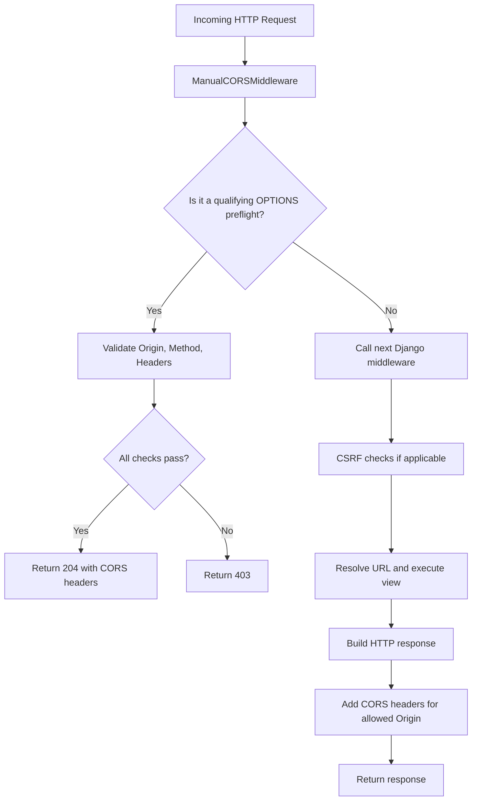

# CORS Fundamentals — Django CORS Learning Lab

## 1. What Is CORS?

**CORS (Cross-Origin Resource Sharing)** is a browser security mechanism that allows a server to specify which origins may access its responses through browser-based cross-origin requests.

Browsers enforce the Same-Origin Policy, which restricts how scripts from one origin interact with resources from another origin. CORS provides a controlled way for servers to grant cross-origin access.

In our project, the frontend runs at `http://127.0.0.1:5500`, while the Django backend runs at `http://127.0.0.1:8000`.

Because the ports differ, these applications have different origins. When JavaScript in the frontend calls the backend, the browser applies CORS rules.

### What problem does CORS solve?

Imagine a website tries to read data from another website without that server permitting browser-based access. The Same-Origin Policy restricts the script's ability to read the cross-origin response.

CORS allows the server to communicate its cross-origin access policy through HTTP response headers.

**Important:** CORS is not authentication, authorization, or a complete defense against malicious requests. It controls browser access to cross-origin responses; it does not prevent Postman or other non-browser clients from sending HTTP requests.

---

## 2. Understanding Origins

An origin consists of three components:

1. Scheme or protocol.
2. Hostname.
3. Port.

Two URLs have the same origin only when all three components match.

| URL A | URL B | Same origin? | Reason |
|---|---|---|---|
| `http://127.0.0.1:5500` | `http://127.0.0.1:5500/page` | Yes | Scheme, hostname, and port match. |
| `http://127.0.0.1:5500` | `http://127.0.0.1:8000` | No | Ports differ. |
| `http://127.0.0.1:5500` | `http://localhost:5500` | No | Hostnames differ. |
| `http://127.0.0.1:5500` | `https://127.0.0.1:5500` | No | Schemes differ. |

### Our project's origins

| Component | Frontend | Backend |
|---|---|---|
| Scheme | `http` | `http` |
| Hostname | `127.0.0.1` | `127.0.0.1` |
| Port | `5500` | `8000` |
| Origin | `http://127.0.0.1:5500` | `http://127.0.0.1:8000` |

The frontend and backend are cross-origin because their ports differ.

Using the same hostname consistently also avoids confusion when managing cookies. Cookies are not scoped by port, but `localhost` and `127.0.0.1` are different hosts.

---

## 3. Same-Origin Policy vs. CORS

The Same-Origin Policy is a browser security policy. CORS is a mechanism through which a server can grant specific cross-origin access.

| Feature | Same-Origin Policy | CORS |
|---|---|---|
| Main purpose | Restricts certain cross-origin interactions | Allows controlled cross-origin access |
| Enforced by | Browser | Browser evaluates the server's CORS response |
| Server configuration | Not a CORS allowlist itself | Server specifies allowed origins and related permissions |
| Example | Frontend cannot freely read another origin's response | Backend grants access to `http://127.0.0.1:5500` |
| Authentication | Does not authenticate users | Does not authenticate users |

Without valid CORS permission, a browser may block JavaScript from accessing a cross-origin response. For a request requiring preflight, the browser normally prevents the actual request from being sent if the preflight fails.

For a simple cross-origin request, the browser may send the request but refuse to expose its response to JavaScript if the CORS check fails.

Therefore, CORS does not mean that every unauthorized-origin request is prevented from reaching the server.

---

## 4. How CORS Works in Our Project

Our custom CORS middleware is located at:

```text
backend/api/middleware.py
```

The middleware uses an explicit origin allowlist:

```python
ALLOWED_ORIGINS = {
    "http://127.0.0.1:5500",
}
```

This means the middleware recognizes that exact origin as allowed.

When a qualifying OPTIONS preflight arrives, the middleware checks:

- Whether the `Origin` is allowed.
- Whether the intended HTTP method is allowed.
- Whether the requested headers are allowed.

If all checks pass, the middleware returns `204 No Content` with the relevant CORS headers.

If a preflight check fails, our custom middleware returns `403 Forbidden`.

For normal requests, the middleware calls the next Django middleware and adds CORS response headers when the origin is allowed.

### CORS middleware flow



This diagram represents our custom middleware's behavior. A normal request that fails CSRF validation may return a CSRF error instead of reaching the view.

---

## 5. Important CORS Request and Response Headers

CORS uses HTTP headers to communicate the server's cross-origin policy.

| Header | Direction | Purpose |
|---|---|---|
| `Origin` | Request | Identifies the origin initiating the browser request. |
| `Access-Control-Request-Method` | Preflight request | Specifies the intended actual HTTP method. |
| `Access-Control-Request-Headers` | Preflight request | Lists the headers the actual request intends to use. |
| `Access-Control-Allow-Origin` | Response | Identifies an origin permitted to access the response. |
| `Access-Control-Allow-Methods` | Preflight response | Lists the methods permitted by the CORS policy. |
| `Access-Control-Allow-Headers` | Preflight response | Lists the request headers permitted by the CORS policy. |
| `Access-Control-Allow-Credentials` | Response | Indicates whether the browser may expose the response to a credentialed CORS request. |
| `Access-Control-Max-Age` | Preflight response | Specifies how long the browser may cache preflight permission, subject to browser limits. |
| `Vary: Origin` | Response | Indicates that the response may vary according to the request origin. |

Our middleware uses these headers to implement its learning-focused CORS policy.

### Example preflight request

```http
OPTIONS /api/ HTTP/1.1
Host: 127.0.0.1:8000
Origin: http://127.0.0.1:5500
Access-Control-Request-Method: POST
Access-Control-Request-Headers: content-type,x-csrftoken
```

### Example approved response

```http
HTTP/1.1 204 No Content
Access-Control-Allow-Origin: http://127.0.0.1:5500
Access-Control-Allow-Methods: DELETE, GET, PATCH, POST
Access-Control-Allow-Headers: Content-Type, Authorization, X-CSRFToken
Access-Control-Allow-Credentials: true
Access-Control-Max-Age: 600
```

The exact method order depends on the middleware's implementation. The important point is that the response must grant the requested method and headers and must satisfy the browser's CORS checks.

---

## 6. Why Some Requests Need Preflight

A browser does not send an OPTIONS preflight for every cross-origin request.

A request can qualify as a CORS simple request when it meets the requirements for safelisted methods, headers, and content types. Other cross-origin requests normally require preflight.

| Example request | Preflight normally required? | Reason |
|---|---|---|
| GET with ordinary safelisted headers | No | It may qualify as a simple request. |
| POST with `Content-Type: application/json` | Yes | JSON is not a CORS-safelisted content type. |
| POST with `X-CSRFToken` | Yes | This custom header is not CORS-safelisted. |
| DELETE | Yes | DELETE is not a CORS-safelisted method. |
| PATCH | Yes | PATCH is not a CORS-safelisted method. |

### Our JSON POST

```javascript
fetch("http://127.0.0.1:8000/api/", {
    method: "POST",
    credentials: "include",
    headers: {
        "Content-Type": "application/json",
        "X-CSRFToken": csrfToken,
    },
    body: JSON.stringify({
        name: "Laptop",
    }),
});
```

This request normally triggers preflight because it uses JSON content type and a custom CSRF header.

The browser automatically creates the OPTIONS request. We do not need to manually call `fetch()` with `method: "OPTIONS"` in the frontend.

---

## 7. Allowed Origins, Methods, and Headers

Our middleware defines three allowlists.

```python
ALLOWED_ORIGINS = {
    "http://127.0.0.1:5500",
}

ALLOWED_METHODS = {
    "GET",
    "POST",
    "PATCH",
    "DELETE",
}

ALLOWED_HEADERS = {
    "content-type",
    "authorization",
    "x-csrftoken",
}
```

### What each allowlist means

| Configuration | What it controls | Example |
|---|---|---|
| `ALLOWED_ORIGINS` | Which origins pass the middleware's origin check | `http://127.0.0.1:5500` |
| `ALLOWED_METHODS` | Which intended HTTP methods pass preflight validation | `POST` |
| `ALLOWED_HEADERS` | Which requested headers pass preflight validation | `content-type`, `x-csrftoken` |

The middleware normalizes requested method and header names before comparing them. This makes the checks consistent despite header-name casing.

### What happens when a check fails?

| Scenario | Middleware result |
|---|---|
| Allowed origin, POST, allowed headers | `204 No Content` |
| Unapproved origin | `403 Forbidden` |
| Unapproved requested method | `403 Forbidden` |
| Unapproved requested header | `403 Forbidden` |

These results describe our custom preflight handling. They are not universal status codes required for every CORS implementation.

---

## 8. Credentials, Cookies, and CORS

A credentialed browser request may include cookies or other browser-managed credentials.

In our frontend, we use:

```javascript
credentials: "include"
```

This tells the browser to include credentials on the cross-origin request when permitted by cookie policies.

Our middleware responds with:

```http
Access-Control-Allow-Origin: http://127.0.0.1:5500
Access-Control-Allow-Credentials: true
```

These headers are important because a credentialed CORS request cannot use `Access-Control-Allow-Origin: *`.

The browser requires a specific permitted origin and the appropriate credential permission before exposing the response to JavaScript.

### Important cookie distinction

Cookies are scoped by domain or host and path, not by port. However, `localhost` and `127.0.0.1` are different hosts.

Using `127.0.0.1` consistently for backend requests prevents the project from accidentally requesting a cookie from one hostname while sending a request to the other.

The browser's SameSite and Secure cookie rules also apply. CORS headers alone cannot override those rules.

---

## 9. CORS vs. CSRF and Common Misunderstandings

CORS and CSRF are separate security mechanisms.

| Question | CORS | CSRF |
|---|---|---|
| What does it protect or control? | Browser access to cross-origin responses | Helps prevent forged unsafe requests |
| Where is it implemented here? | `ManualCORSMiddleware` | Django `CsrfViewMiddleware` |
| Does Postman enforce browser CORS? | No | Django's CSRF checks still apply |
| Can a successful preflight guarantee POST success? | No | The POST must still pass CSRF and other checks |
| Does it authenticate a user? | No | No |

### Common mistakes

**Mistake 1: Assuming CORS is authentication.**

CORS does not verify a user's identity or permissions.

**Mistake 2: Assuming every cross-origin request sends OPTIONS.**

Only requests requiring preflight trigger it.

**Mistake 3: Assuming a `204` response means the POST succeeded.**

The `204` is the preflight response, not the actual POST response.

**Mistake 4: Assuming Postman proves browser CORS behavior.**

Postman does not enforce the browser's CORS rules. Use a browser to verify the complete CORS interaction.

**Mistake 5: Disabling CSRF to fix CORS.**

CSRF should remain enabled where required. Fix the missing token or cookie instead.

---

## 10. Test Results, Production Guidance, and Key Takeaways

### Verified results from our learning project

| Test | Observed result | What it demonstrates |
|---|---|---|
| Browser GET | `200 OK` | The frontend can read the welcome response. |
| Browser CSRF-protected POST | `200 OK` | The request passed CSRF validation and reached the view. |
| Postman CSRF-protected POST | `200 OK` | The request supplied the required token and cookie. |
| OPTIONS with `http://127.0.0.1:5500` | `204 No Content` | The custom middleware approved the tested preflight. |
| OPTIONS with `http://localhost:5500` | `403 Forbidden` | The custom middleware rejected the unapproved origin. |

These results verify the tested scenarios, not every possible CORS configuration or security case.

### Production considerations

Before deploying a Django application:

- Use HTTPS.
- Configure the real frontend origins explicitly.
- Keep CSRF protection enabled where appropriate.
- Store secret keys in environment variables.
- Configure secure cookies and trusted origins correctly.
- Use a maintained CORS package or carefully managed gateway where appropriate.
- Avoid wildcard origins for credentialed requests.
- Test both browser behavior and backend request validation.
- Treat CORS as one component of security, not a replacement for authentication and authorization.

### Final takeaway

CORS enables controlled browser access to cross-origin resources through server response headers.

In our Django CORS Learning Lab, custom middleware checks preflight origins, methods, and headers, while Django's CSRF middleware validates unsafe requests.

The most important distinction is:

**CORS controls browser access to responses; CSRF protection validates unsafe requests. A successful CORS preflight does not guarantee that the actual request will pass every other security check.**

### Related documentation

- [Project Architecture](01-project-architecture.md)
- [OPTIONS Preflight Flow](03-options-preflight-flow.md)
- [CSRF Protection Flow](04-csrf-protection-flow.md)
- [Testing and Troubleshooting](05-testing-and-troubleshooting.md)
