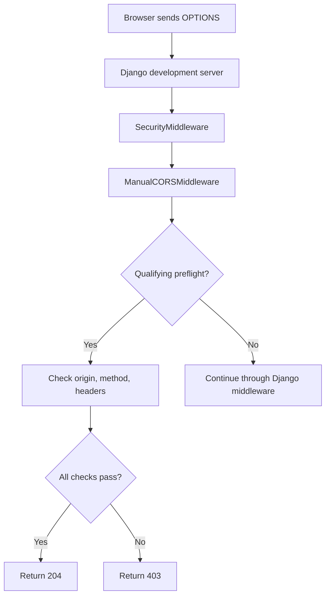
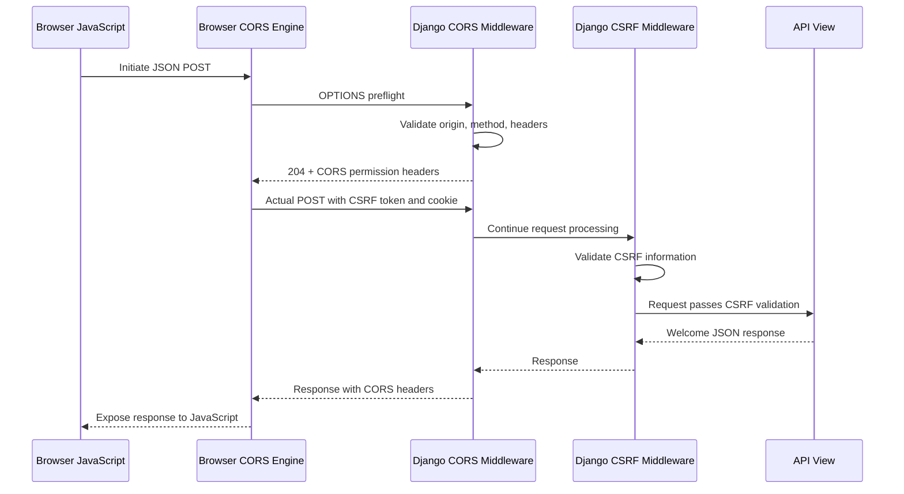
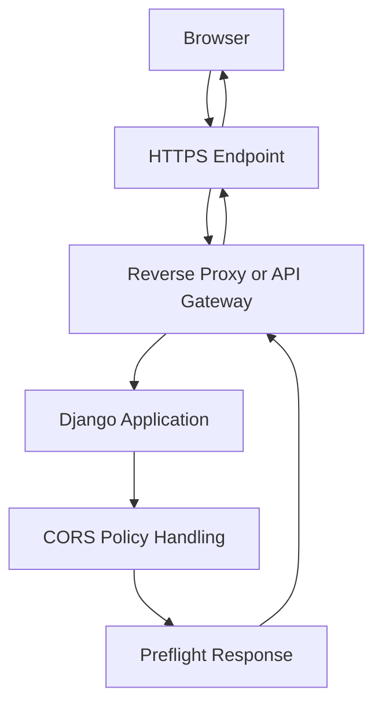

# OPTIONS Preflight Flow — Django CORS Learning Lab

## 1. What Is an OPTIONS Preflight Request?

`OPTIONS` is an HTTP method used to ask a server about the communication options available for a resource.

In Cross-Origin Resource Sharing (CORS), a browser uses an OPTIONS request as a **preflight** when it needs to check whether a cross-origin request is permitted before sending the actual request.

In our project, the frontend runs at `http://127.0.0.1:5500`, and Django runs at `http://127.0.0.1:8000`.

When our JavaScript sends a JSON POST request with the custom `X-CSRFToken` header, the browser normally performs a preflight first.

### Why is preflight needed?

The browser needs to determine whether the backend permits the intended:

- Origin.
- HTTP method.
- Request headers.

The server communicates its CORS policy through response headers. The browser evaluates those headers before deciding whether to send the actual request.

**Important:** Not every cross-origin request requires preflight. Requests that qualify as CORS simple requests may be sent without an OPTIONS request.

---

## 2. When Does the Browser Send OPTIONS?

The browser decides automatically whether a cross-origin request requires preflight. Developers normally do not need to write separate JavaScript to send it.

| Actual request | Preflight normally required? | Reason |
|---|---|---|
| GET with safelisted headers | No | It may qualify as a simple request. |
| POST with `Content-Type: application/json` | Yes | JSON is not a CORS-safelisted content type. |
| POST with `X-CSRFToken` | Yes | This custom header is not safelisted. |
| DELETE | Yes | DELETE is not a CORS-safelisted method. |
| PATCH | Yes | PATCH is not a CORS-safelisted method. |

Our frontend POST combines JSON content type and a custom CSRF header, so the browser normally sends an OPTIONS preflight before the actual POST.

### Example frontend request

```javascript
fetch("http://127.0.0.1:8000/api/", {
    method: "POST",
    credentials: "include",
    headers: {
        "Content-Type": "application/json",
        "X-CSRFToken": csrfToken,
    },
    body: JSON.stringify({
        name: "Laptop",
    }),
});
```

The browser automatically determines that preflight is required. It first asks the server for permission to send this kind of request.

---

## 3. Understanding the Preflight Request Headers

The browser sends an OPTIONS request containing information about the intended actual request.

### Example request

```http
OPTIONS /api/ HTTP/1.1
Host: 127.0.0.1:8000
Origin: http://127.0.0.1:5500
Access-Control-Request-Method: POST
Access-Control-Request-Headers: content-type,x-csrftoken
```

### Meaning of each header

| Header | Meaning |
|---|---|
| `OPTIONS /api/` | The preflight targets the `/api/` resource. |
| `Host` | Identifies the destination host and port. |
| `Origin` | Identifies the frontend origin that initiated the cross-origin request. |
| `Access-Control-Request-Method` | Specifies the intended actual method, which is POST here. |
| `Access-Control-Request-Headers` | Lists the headers the actual request intends to use. |

Notice that the HTTP method of this request is `OPTIONS`, but the value of `Access-Control-Request-Method` is `POST`.

The latter describes the **future actual request**, not the preflight itself.

The preflight normally does not contain the actual POST body. It checks permission before the browser sends that body.

---

## 4. How the OPTIONS Request Reaches Django

Our backend runs using Django's development server.

The browser sends the preflight to:

```text
http://127.0.0.1:8000/api/
```

Django processes the request through its configured middleware stack.

Our relevant middleware configuration is:

```python
MIDDLEWARE = [
    "django.middleware.security.SecurityMiddleware",
    "api.middleware.ManualCORSMiddleware",
    "django.contrib.sessions.middleware.SessionMiddleware",
    "django.middleware.common.CommonMiddleware",
    "django.middleware.csrf.CsrfViewMiddleware",
    # Other configured middleware...
]
```

`ManualCORSMiddleware` appears before `CsrfViewMiddleware`.

This is important because the custom middleware recognizes qualifying preflight requests and handles them before normal processing reaches the CSRF middleware or the API view.

The preflight does not need to execute `home()` to decide whether the requested cross-origin operation is permitted.

### Middleware path



This describes the custom middleware's qualifying-preflight path. An OPTIONS request that does not meet the middleware's preflight-detection condition is not automatically handled by the same branch.

---

## 5. How Our Middleware Validates the Preflight

Our `backend/api/middleware.py` defines these allowlists:

```python
ALLOWED_ORIGINS = {
    "http://127.0.0.1:5500",
}

ALLOWED_METHODS = {
    "GET",
    "POST",
    "PATCH",
    "DELETE",
}

ALLOWED_HEADERS = {
    "content-type",
    "authorization",
    "x-csrftoken",
}
```

For a qualifying preflight, the middleware reads the origin, requested method, and requested headers.

It normalizes the requested method and header names before checking them against the allowlists.

The main decision is:

```python
allowed = (
    origin in ALLOWED_ORIGINS
    and requested_method in ALLOWED_METHODS
    and requested_headers.issubset(ALLOWED_HEADERS)
)
```

### What does each condition do?

| Condition | Question being answered |
|---|---|
| `origin in ALLOWED_ORIGINS` | Is this origin permitted by our policy? |
| `requested_method in ALLOWED_METHODS` | Is the intended actual HTTP method permitted? |
| `requested_headers.issubset(ALLOWED_HEADERS)` | Are all requested headers included in our allowed-header set? |

All three conditions must be true for this middleware to approve the preflight.

If even one condition fails, the custom middleware returns `403 Forbidden`.

---

## 6. Successful Preflight: Why We Receive 204

In our implementation, the successful branch creates a response with status `204` and adds CORS headers.

```python
response = HttpResponse(status=204)

response["Access-Control-Allow-Origin"] = origin
response["Access-Control-Allow-Methods"] = ", ".join(
    sorted(ALLOWED_METHODS)
)
response["Access-Control-Allow-Headers"] = (
    "Content-Type, Authorization, X-CSRFToken"
)
response["Access-Control-Allow-Credentials"] = "true"
response["Access-Control-Max-Age"] = "600"

patch_vary_headers(
    response,
    (
        "Origin",
        "Access-Control-Request-Method",
        "Access-Control-Request-Headers",
    ),
)

return response
```

### Meaning of the response headers

| Header | Purpose |
|---|---|
| `Access-Control-Allow-Origin` | Identifies the permitted origin. |
| `Access-Control-Allow-Methods` | Lists methods allowed by the middleware. |
| `Access-Control-Allow-Headers` | Lists request headers allowed by the middleware. |
| `Access-Control-Allow-Credentials` | Allows credentialed CORS access when the browser's other requirements are satisfied. |
| `Access-Control-Max-Age` | Allows the browser to cache preflight permission, subject to browser limits. |
| `Vary` | Signals that the response can vary according to the request's origin and requested method or headers. |

`204 No Content` means the server handled the request successfully without returning a response body.

The browser evaluates the returned headers to determine whether the requested cross-origin operation is permitted.

The response does not mean the actual POST has already executed.

---

## 7. Rejected Preflight: Why We Receive 403

Our middleware returns `403 Forbidden` when a qualifying preflight fails its allowlist checks.

For example, the configured allowed origin is:

```text
http://127.0.0.1:5500
```

But our negative-origin test used:

```text
http://localhost:5500
```

These are different origins because their hostnames differ.

### Test results

| Request origin | Origin allowed? | Observed result |
|---|---|---|
| `http://127.0.0.1:5500` | Yes | `204 No Content` |
| `http://localhost:5500` | No | `403 Forbidden` |

We verified these results by sending preflight-shaped OPTIONS requests in Postman.

The unapproved origin fails this condition:

```python
origin in ALLOWED_ORIGINS
```

The middleware returns `403` immediately, without continuing through the remaining Django middleware or executing the API view.

**Important:** This `403` is the response chosen by our custom implementation. CORS specifications do not require every server to use this exact status code for every rejected preflight.

---

## 8. What Happens After a Successful Preflight?

After receiving a successful preflight response, the browser evaluates the CORS permission headers.

If the preflight passes, the browser may proceed with the actual POST.

The actual request contains the application data and the relevant CSRF information.

### Actual POST request

```http
POST /api/ HTTP/1.1
Host: 127.0.0.1:8000
Origin: http://127.0.0.1:5500
Content-Type: application/json
X-CSRFToken: <csrf-token>
Cookie: csrftoken=<matching-cookie>
```

The actual request then follows normal Django processing:

1. The CORS middleware passes the request to the next middleware.
2. Django's CSRF middleware validates the CSRF information.
3. Django resolves `/api/` to the `home()` view.
4. The view returns the welcome JSON.
5. The response travels back through the middleware stack.
6. The CORS middleware adds the appropriate response headers for the allowed origin.
7. The browser checks the CORS response and exposes the response to JavaScript if permitted.

### End-to-end sequence diagram



This is the successful request path. If preflight fails, the browser normally does not send the actual POST. If CSRF validation fails, the POST can still be rejected after preflight succeeds.

---

## 9. How We Tested OPTIONS in Postman

Postman does not enforce the browser's CORS rules. However, it is useful for testing how our middleware responds to specific HTTP requests and headers.

We used Postman to test both approved and unapproved origins.

### Test A: Approved origin

Method:

```text
OPTIONS
```

URL:

```text
http://127.0.0.1:8000/api/
```

Headers:

| Key | Value |
|---|---|
| `Origin` | `http://127.0.0.1:5500` |
| `Access-Control-Request-Method` | `POST` |
| `Access-Control-Request-Headers` | `content-type,x-csrftoken` |

Observed result:

```text
204 No Content
```

This confirms that the tested request passed the middleware's preflight checks.

### Test B: Unapproved origin

Keep the same method and URL, but change the `Origin` header to:

```text
http://localhost:5500
```

Observed result:

```text
403 Forbidden
```

This confirms that our custom middleware rejected the unapproved origin.

### Why test in both Postman and a browser?

| Tool | What it helps verify |
|---|---|
| Postman | Server response codes, request headers, and middleware decisions. |
| Browser | Automatic preflight behavior, CORS enforcement, cookies, CSRF interaction, and JavaScript access to responses. |

Postman verifies the server-side test conditions. Browser testing verifies the complete browser CORS interaction.

---

## 10. Production Behavior and Key Takeaways

In production, the browser's CORS preflight protocol remains the same. However, the request may pass through additional infrastructure such as a reverse proxy, API gateway, or load balancer.

For example:



Depending on the deployment, the proxy or gateway may handle preflight directly, or it may forward the request to Django. The policy must be configured consistently so the response reaching the browser contains the required CORS headers.

### Production considerations

- Use HTTPS for production applications.
- Allow only the frontend origins that actually need access.
- Permit only the methods and request headers required by the application.
- Keep CSRF protection enabled where appropriate.
- Configure credentialed requests using explicit allowed origins rather than `*`.
- Avoid duplicate or conflicting CORS policies between Django and a proxy.
- Test real browser behavior instead of relying only on Postman.
- Remember that CORS is not a replacement for authentication, authorization, or input validation.

### Final takeaways

1. OPTIONS preflight is a browser permission check that happens before certain cross-origin requests.
2. `Access-Control-Request-Method` and `Access-Control-Request-Headers` describe the intended actual request.
3. Our custom middleware checks the origin, method, and headers before returning `204` or `403`.
4. A successful preflight does not guarantee that the actual request will pass CSRF validation.
5. Postman can test middleware behavior, but only a browser can verify actual browser CORS enforcement.

### Related documentation

- [Project Architecture](01-project-architecture.md)
- [CORS Fundamentals](02-cors-fundamentals.md)
- [CSRF Protection Flow](04-csrf-protection-flow.md)
- [Testing and Troubleshooting](05-testing-and-troubleshooting.md)
