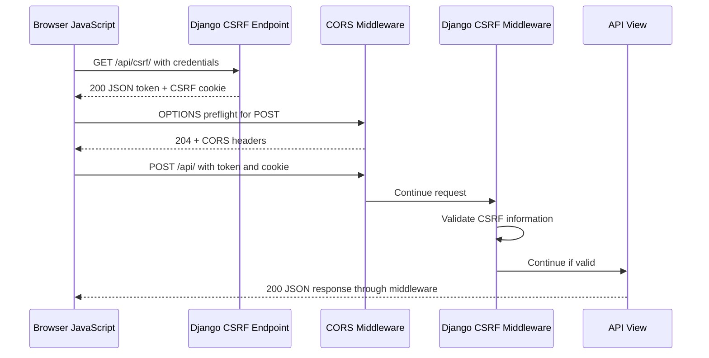

# CSRF Protection Flow — Django CORS Learning Lab

## 1. What Is CSRF Protection?

**CSRF stands for Cross-Site Request Forgery.** It is a type of attack in which a victim's browser is tricked into sending an unwanted request to a website where the victim is already authenticated.

Browsers may automatically attach cookies to requests. If a user is logged in to a website, a malicious website may attempt to make the user's browser send an unwanted request to that website.

Django's Cross-Site Request Forgery protection helps prevent forged unsafe requests by validating CSRF information associated with the request.

In our project, CSRF protection is enabled through Django's middleware:

```python
"django.middleware.csrf.CsrfViewMiddleware",
```

We kept this protection enabled rather than disabling it to make the POST request work.

### Why is CSRF protection needed?

Imagine a user is logged in to a banking application. A malicious website attempts to make the user's browser submit a transfer request using the user's existing session.

Without appropriate protections, the server might receive a request carrying the user's authentication cookie without knowing whether the request was intentionally initiated by the trusted application.

CSRF protection adds validation to help distinguish legitimate unsafe requests from forged ones.

**Important:** CSRF protection does not replace authentication, authorization, or other security controls.

---

## 2. Why Our Project Needed a CSRF Token

Our frontend and backend run at different origins:

```text
Frontend: http://127.0.0.1:5500
Backend:  http://127.0.0.1:8000
```

The frontend sends a JSON POST request to the Django backend.

Django's CSRF middleware validates unsafe requests such as POST. For our configuration, the request must include the required CSRF cookie and a valid token submitted through the `X-CSRFToken` header.

Our original frontend POST did not first obtain the token or explicitly include credentials.

As a result, Django rejected the request.

### Original error

```text
403 Forbidden

CSRF verification failed.
CSRF cookie not set.
```

This error meant that Django could not find the required CSRF cookie for that request.

It was not, by itself, proof of a CORS failure. CORS and CSRF are separate mechanisms that can both affect the same cross-origin request.

---

## 3. How Django's CSRF Mechanism Works

Our project uses two important Django functions and decorators.

| Component | Purpose |
|---|---|
| `get_token(request)` | Gets a CSRF token associated with the current request. |
| `@ensure_csrf_cookie` | Ensures Django sends a CSRF cookie in the response. |
| `CsrfViewMiddleware` | Validates CSRF protection for unsafe requests. |

Our CSRF endpoint is implemented in `backend/api/views.py`.

```python
from django.http import JsonResponse
from django.middleware.csrf import get_token
from django.views.decorators.csrf import ensure_csrf_cookie


@ensure_csrf_cookie
def csrf_token_view(request):
    return JsonResponse({
        "csrfToken": get_token(request),
    })
```

### What happens in this view?

1. The frontend requests the CSRF endpoint.
2. Django calls `csrf_token_view`.
3. `get_token(request)` obtains a CSRF token.
4. `@ensure_csrf_cookie` ensures the response sets the CSRF cookie.
5. Django returns the token in JSON.
6. The frontend can submit that token in the next unsafe request.

The token in the JSON response and the CSRF cookie serve related but distinct roles. Django validates the submitted token against its CSRF protection mechanism and the cookie.

The frontend should not assume that receiving a JSON token alone proves the browser has stored and will send the corresponding cookie.

---

## 4. The CSRF Endpoint and URL Configuration

The project exposes a dedicated endpoint to obtain the token.

### `backend/api/urls.py`

```python
from django.urls import path
from .views import home, csrf_token_view

urlpatterns = [
    path("", home, name="home"),
    path("csrf/", csrf_token_view, name="csrf-token"),
]
```

### `backend/config/urls.py`

```python
from django.contrib import admin
from django.urls import include, path

urlpatterns = [
    path("admin/", admin.site.urls),
    path("api/", include("api.urls")),
]
```

Together, these mappings create the following routes:

| URL | Purpose |
|---|---|
| `/api/` | Returns the welcome JSON. |
| `/api/csrf/` | Returns a CSRF token and ensures the CSRF cookie is set. |

The CSRF endpoint is a GET request. It does not create a record or modify business data.

---

## 5. How the Browser CSRF Flow Works

Our corrected `frontend/script.js` uses a two-request flow.

### Request 1: Obtain the CSRF token

```javascript
const API_URL = "http://127.0.0.1:8000/api/";

const csrfResponse = await fetch(API_URL + "csrf/", {
    credentials: "include",
});

if (!csrfResponse.ok) {
    throw new Error(
        "CSRF endpoint returned " + csrfResponse.status
    );
}

const csrfData = await csrfResponse.json();
```

The browser requests `/api/csrf/`.

Django returns the token and sets the cookie. The `credentials: "include"` option allows the browser to accept and send cookies for the cross-origin request, subject to browser cookie rules and the server's CORS response.

### Request 2: Submit the POST

```javascript
const response = await fetch(API_URL, {
    method: "POST",
    credentials: "include",
    headers: {
        "Content-Type": "application/json",
        "X-CSRFToken": csrfData.csrfToken,
    },
    body: JSON.stringify({
        name: "Laptop",
    }),
});
```

This request includes:

- The POST method.
- The JSON content type.
- The CSRF token in `X-CSRFToken`.
- Credentials so the relevant cookie can be sent.

Because this is a cross-origin JSON request with a custom header, the browser normally sends an OPTIONS preflight before the actual POST.

### Browser request flow



This sequence describes the successful path in our project. If preflight fails, the browser normally does not send the POST. If CSRF validation fails, Django rejects the POST even when preflight succeeded.

---

## 6. Why We Use `credentials: "include"`

The browser's Fetch API does not include cross-origin credentials by default.

Our JavaScript uses:

```javascript
credentials: "include"
```

This allows the browser to include relevant cookies in the cross-origin request when cookie policies permit it. It also permits the browser to accept cookies from eligible cross-origin responses.

Our custom CORS middleware adds these response headers for allowed origins:

```http
Access-Control-Allow-Origin: http://127.0.0.1:5500
Access-Control-Allow-Credentials: true
```

For credentialed CORS requests, the server must return the explicit permitted origin rather than `Access-Control-Allow-Origin: *`.

### Hostname consistency matters

Our project uses:

```text
http://127.0.0.1:8000
```

for all backend requests.

We avoid switching between `localhost` and `127.0.0.1` because they are different hosts. Cookies set for one host are not automatically the same cookies as those associated with the other host.

Cookies are not scoped by port, but host, path, Secure, SameSite, and other cookie rules affect whether a cookie is sent.

---

## 7. Why the Postman POST Initially Returned 403

Postman is not a browser, so it does not enforce browser CORS restrictions. However, Django's CSRF middleware still validates incoming requests.

Our original direct POST from Postman returned:

```text
403 Forbidden
```

The request did not contain the required matching CSRF cookie and submitted token.

We fixed this by obtaining the token first and then sending the token and cookie with the POST.

### Step 1: Obtain the token

Method:

```text
GET
```

URL:

```text
http://127.0.0.1:8000/api/csrf/
```

Expected JSON response:

```json
{
    "csrfToken": "your-csrf-token-here"
}
```

The real token is generated by Django and will differ from this example.

Postman should also store the `csrftoken` cookie from the response. If it does not, check the cookie manager for the `127.0.0.1` host and confirm the cookie is sent with the POST.

### Step 2: Send the POST

Method:

```text
POST
```

URL:

```text
http://127.0.0.1:8000/api/
```

Body → raw → JSON:

```json
{
    "name": "Laptop"
}
```

Headers:

| Key | Value |
|---|---|
| `Content-Type` | `application/json` |
| `X-CSRFToken` | The actual `csrfToken` value from Step 1 |

Make sure the matching `csrftoken` cookie is included.

### Observed result

The POST returned:

```text
200 OK
```

with the welcome JSON response.

This confirmed that the Postman request passed the applicable CSRF validation and reached the view.

---

## 8. Understanding CSRF Errors and Their Causes

Different CSRF errors indicate different validation failures.

| Error or symptom | Possible cause | What to check |
|---|---|---|
| `CSRF cookie not set` | Required cookie is missing | Call the CSRF endpoint and check whether the cookie is set and sent. |
| `CSRF token missing` | Required submitted token is missing | Include `X-CSRFToken` in the unsafe request. |
| CSRF token incorrect | Submitted token does not validate | Obtain a fresh token and use the corresponding cookie. |
| CSRF origin verification failed | The request origin does not meet Django's trusted-origin requirements | Check `CSRF_TRUSTED_ORIGINS` and the actual request origin. |
| CORS error in the browser | The browser could not validate the required CORS response | Check the origin, CORS headers, preflight response, and browser console. |

These are troubleshooting possibilities, not interchangeable errors. Read Django's exact response message before deciding which fix is appropriate.

### Important distinction

A successful OPTIONS preflight does not guarantee CSRF success. The preflight checks the CORS policy; Django's CSRF middleware performs its own validation on the actual unsafe request.

Do not disable CSRF protection merely to make the POST return `200`.

---

## 9. Security Considerations and Production Practices

Our project is a learning implementation. A production application requires additional care.

### Recommended practices

- Keep Django's CSRF protection enabled where required.
- Use HTTPS in production.
- Use secure environment-based configuration for the Django secret key.
- Configure `CSRF_TRUSTED_ORIGINS` for the intended origins where necessary.
- Configure `CSRF_COOKIE_SECURE` and `SESSION_COOKIE_SECURE` appropriately for HTTPS deployments.
- Review SameSite cookie settings according to the application's cross-site requirements.
- Use an explicit CORS origin allowlist for credentialed browser requests.
- Avoid disabling CSRF middleware or applying `@csrf_exempt` simply to bypass an error.
- Keep authentication and authorization separate from CSRF protection.
- Test browser behavior as well as server responses in Postman.

### What CSRF protection does not replace

CSRF protection does not prove that a user has permission to perform an operation. An authenticated user may still be unauthorized to access a particular resource.

The application must still validate the user's identity, permissions, submitted data, and business rules.

---

## 10. Verified Results and Final Takeaways

### Results verified in our project

| Test | Observed result | Meaning |
|---|---|---|
| GET `/api/csrf/` in the browser | `200 OK` with `csrfToken` | The CSRF endpoint returns a token. |
| Browser POST after the fix | `200 OK` | The request passed CSRF validation and reached the view. |
| Initial Postman POST | `403 Forbidden` | The request lacked the required CSRF information. |
| Postman POST after the fix | `200 OK` | The token and matching cookie were supplied successfully. |

These results verify the tested flows. They do not prove that every CSRF attack scenario or production cookie configuration has been tested.

### Final takeaways

1. CSRF protection helps prevent forged unsafe requests that abuse a user's browser credentials.
2. Django provides CSRF token generation and request validation.
3. Our frontend obtains the token from `/api/csrf/` and sends it in the `X-CSRFToken` header.
4. The corresponding CSRF cookie must also be sent and accepted by Django.
5. CORS and CSRF are separate mechanisms: passing one does not guarantee passing the other.
6. Postman does not enforce browser CORS, but Django's CSRF validation still applies.
7. The correct solution to a missing CSRF token or cookie is to fix the request flow, not disable protection.

### Related documentation

- [Project Architecture](01-project-architecture.md)
- [CORS Fundamentals](02-cors-fundamentals.md)
- [OPTIONS Preflight Flow](03-options-preflight-flow.md)
- [Testing and Troubleshooting](05-testing-and-troubleshooting.md)
